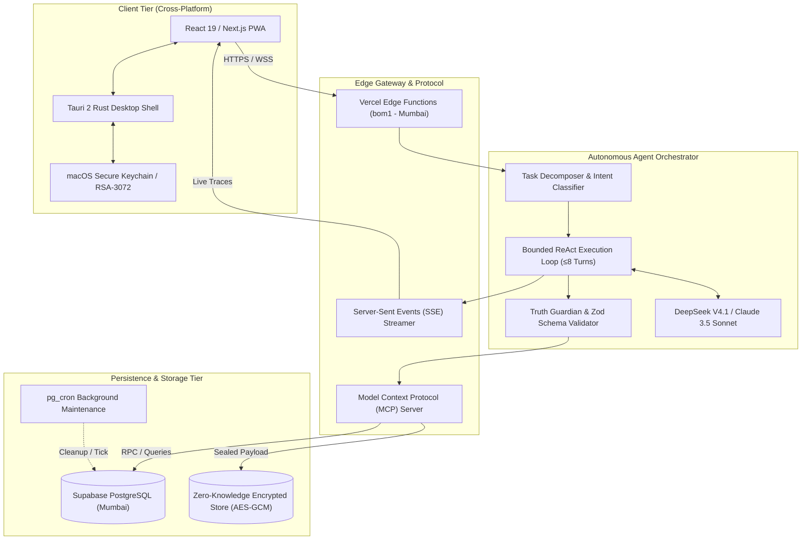

<p align="center">
  
</p>

<p align="center">
  <a href="https://github.com/Gauravkarthikeyan">
    
  </a>
</p>

<p align="center">
  <a href="https://gkagent.vercel.app"></a>
  <a href="mailto:gauravkarthik22@gmail.com"></a>
  <a href="https://github.com/Gauravkarthikeyan"></a>
  <a href="https://github.com/Gauravkarthikeyan?tab=followers"></a>
</p>

---

### ⚡ Executive Overview

```rust
pub struct Engineer {
    pub name: &'static str,
    pub title: &'static str,
    pub core_disciplines: [&'static str; 4],
    pub design_tenet: &'static str,
}

const GAURAV: Engineer = Engineer {
    name: "Gaurav Karthik",
    title: "AI Systems Architect & Full-Stack Platform Engineer",
    core_disciplines: [
        "Autonomous Agent Runtimes & Deterministic DAG Execution",
        "Zero-Knowledge Cryptographic Enclaves (RSA-3072 + AES-GCM)",
        "Distributed Edge Runtimes & Low-Latency Relational Stores",
        "Cross-Platform Native Systems (Tauri 2 / Rust IPC Bridges)",
    ],
    design_tenet: "Eliminate cognitive overhead through verified, self-healing machine autonomy.",
};
```

---

### 🚀 Flagship Systems & Architecture

<table>
  <tr>
    <td width="50%" valign="top">
      <h3 align="left">
        <a href="https://github.com/gauravandkarthikdevelopers/gkagent">🤖 GkAgent</a>
        <br />
        <sub><code>Personal AI Chief of Staff & Cross-Platform Agent OS</code></sub>
      </h3>
      <p>
        
        
      </p>
      <ul>
        <li><b>Native & Web Co-Design:</b> Shared React 19 UI running simultaneously as a mobile PWA and a native macOS app via <b>Tauri 2 (Rust)</b> with OS-level Secure Enclave Keychain storage, global hotkeys (<code>⌥⇧Space</code>), and deep linking (<code>gkagent://</code>).</li>
        <li><b>Zero-Knowledge E2EE:</b> Client-side <b>RSA-OAEP-3072 + AES-256-GCM</b> cryptographic vault with PBKDF2-SHA256 (600k iterations). Allows the agent to write encrypted memories without the server possessing decryption keys.</li>
        <li><b>Autonomous Task Engine:</b> Bounded ReAct loops with strict Zod validation, tool routing via Model Context Protocol (MCP), and <code>pg_cron</code> dispatch on Supabase Postgres. Edge functions co-located in Mumbai (<code>bom1</code>) for sub-50ms roundtrips.</li>
      </ul>
      <p>
        <b>Tech:</b> <code>Next.js 16</code> · <code>Tauri 2 (Rust)</code> · <code>Supabase</code> · <code>Drizzle ORM</code> · <code>MCP</code> · <code>DeepSeek V4.1</code>
      </p>
    </td>
    <td width="50%" valign="top">
      <h3 align="left">
        <a href="https://github.com/Gauravkarthikeyan">🥋 StackNinja</a>
        <br />
        <sub><code>Autonomous Bug-to-Verified-Fix Engineering Engine</code></sub>
      </h3>
      <p>
        
        
      </p>
      <ul>
        <li><b>Autonomous Loop:</b> Transforms unstructured bug tickets into sandboxed browser reproductions, AST-level codebase surgery, and verified regression test suites.</li>
        <li><b>Multi-Agent Directed Graph:</b> 9 decoupled specialized agents (Triage, Headless Inspector, Root-Cause, Patch Repair, Guardian, Verifier) coordinated across an acyclic phase DAG.</li>
        <li><b>Zero-Tolerance Verification:</b> A patch is rejected unless the headless reproduction flips strictly green and full regression passes cleanly before creating signed Git commits.</li>
        <li><b>Real-Time Event Stream:</b> Low-latency SSE telemetry pipeline streaming agent thought traces, AST diffs, and execution logs.</li>
      </ul>
      <p>
        <b>Tech:</b> <code>TypeScript</code> · <code>Playwright</code> · <code>Vitest</code> · <code>Prisma</code> · <code>DeepSeek V3</code> · <code>SSE</code>
      </p>
    </td>
  </tr>
  <tr>
    <td width="50%" valign="top">
      <h3 align="left">
        <a href="https://github.com/hackering-2-0/HR2-AI-D49B63C4">🏛️ Mosaic Office (Hackring 2.0)</a>
        <br />
        <sub><code>Autonomous Multilingual Campaign Studio</code></sub>
      </h3>
      <p>
        
        
      </p>
      <ul>
        <li><b>Deterministic Truth Guardian:</b> Rule-based fact-checking firewall parsing a "Campaign Constitution" to syntactically validate prices, claims, and dates against source grounding, eliminating hallucinations.</li>
        <li><b>Economic & Rate Gateway:</b> Custom AI Gateway maintaining strict token ledgers, rate caps (55 req/min), and granular spend metrics (~₹3 per 8-asset campaign).</li>
        <li><b>Multimodal Generation:</b> Local audio transcription via <code>whisper.cpp</code>, multilingual synthesis with Sarvam AI, and diffusion pipelines via FLUX.1.</li>
      </ul>
      <p>
        <b>Tech:</b> <code>Python</code> · <code>FastAPI</code> · <code>React 19</code> · <code>Vite</code> · <code>whisper.cpp</code> · <code>FLUX.1</code> · <code>SQLite</code>
      </p>
    </td>
    <td width="50%" valign="top">
      <h3 align="left">
        <a href="https://github.com/Gauravkarthikeyan/GlobeWatch">🌐 GlobeWatch</a>
        <br />
        <sub><code>Global Supply Chain Intelligence & Risk Engine</code></sub>
      </h3>
      <p>
        
        
      </p>
      <ul>
        <li><b>Corridor Telemetry:</b> Real-time monitoring of maritime bottlenecks, air freight congestion, and geopolitical disruptions affecting international shipping lanes.</li>
        <li><b>Geospatial Ingestion:</b> High-throughput streaming data pipeline indexing trade flow anomalies with responsive client-side WebGL vector rendering.</li>
        <li><b>Predictive Vulnerability Analysis:</b> Graph models correlating choke point delays with upstream inventory and supplier exposure risks.</li>
      </ul>
      <p>
        <b>Tech:</b> <code>TypeScript</code> · <code>Next.js</code> · <code>TailwindCSS</code> · <code>Geospatial APIs</code> · <code>REST/WebSocket</code>
      </p>
    </td>
  </tr>
</table>

---

### 🛠️ Technical Arsenal & Core Competencies

```ascii
+---------------------------------------------------------------------------------------+
|  DOMAIN                | TECHNOLOGIES & RUNTIMES                                      |
+---------------------------------------------------------------------------------------+
|  Languages & Core      | TypeScript (Node/Bun), Python 3.12+, Rust, Go, SQL, C++      |
|  AI & Agent Runtimes   | DeepSeek V3/V4, Claude 3.5 Sonnet, MCP, LangChain, LlamaIndex|
|  Frontend & Native     | Next.js 15/16 (App Router), React 19, Tauri 2, Tailwind v4   |
|  Data & State Stores   | PostgreSQL, Supabase, Drizzle ORM, Prisma, SQLite, Redis     |
|  Infra, Edge & CI/CD   | Docker, Vercel Edge Runtime, Cloudflare Workers, GitHub Actions|
|  Security & Crypto     | RSA-OAEP-3072, AES-256-GCM, PBKDF2, macOS Keychain Enclaves   |
+---------------------------------------------------------------------------------------+
```

<p align="center">
  
</p>

---

### 📊 Production Telemetry & Activity

<p align="center">
  <a href="https://github.com/Gauravkarthikeyan">
    
  </a>
  <a href="https://github.com/Gauravkarthikeyan">
    
  </a>
</p>

<p align="center">
  <a href="https://github.com/Gauravkarthikeyan">
    
  </a>
</p>

---

<details>
  <summary><b>📐 System Architecture Blueprint: Deterministic Autonomous Agent Loop</b></summary>
  <br />


</details>

---

<p align="center">
  <sub>Engineered by <b>Gaurav Karthik</b> • Crafted with precision, verified autonomy, and high-performance systems.</sub>
</p>
