I'm Gaurav. Right now that means two things in Go: a replicated key-value store with a simulator that attacks it, and a scheduler that drops work once it's too late to matter. Around those I ship web apps, and I run my day on an assistant I built. I study Computer Science & Engineering at Saptagiri NPS University in Bengaluru.

## [Tessera](https://github.com/Gauravkarthikeyan/Tessera)



A multi-tenant key-value store. Data is split into key-range partitions, and each partition is its own 3-way Raft group. Hot partitions split themselves, tenants are rate-limited at two levels, and routers are shuffle-sharded so one noisy tenant can't take the others down.

The simulator is the point. It crashes nodes, partitions the network, drops 20% of packets, and duplicates and reorders messages. Afterwards it checks every client operation for linearizability. When something breaks you get a seed that replays it bit for bit. The checker gets tested too: Tessera ships six bugs you can switch on, and it catches five of them within a handful of seeds.

```sh
git clone https://github.com/Gauravkarthikeyan/Tessera && cd Tessera
go run ./cmd/tessera-sim -seeds 100
```

Pure Go, standard library only, about 3.6k lines.

## [Kairos](https://github.com/Gauravkarthikeyan/kairos)

Cron and most job queues run work in the order it arrived. Under overload, the queue fills with jobs that are already late, and they block the ones that still matter. Kairos asks each job one more question: what does it cost if you finish me late? You answer with a small value curve, and the scheduler maximizes total value instead of arrival order. Jobs that can no longer earn anything get dropped.



These are synthetic workloads with made-up curves, from the repo's own simulator. They show the mechanism works. Your numbers depend on your curves.

```sh
go install github.com/Gauravkarthikeyan/kairos/cmd/kairos@latest
kairos simulate -sweep
```

## Private, and turning into products

These two repos are closed while I build businesses on top of them.

**GkAgent** is my assistant, Pip. It turns what I say into real records (reminders, calendar events, tasks, habits, workouts, expenses), follows up from the server when the app is closed, and reports only what actually happened. It runs as an installable PWA and a native Mac app (Tauri and Rust) on the same database, and coding agents can update it over MCP. Next.js, Vercel, Supabase Postgres. Hosting costs ₹0 a month.

**Mosaic** is a marketing agency in one app for local businesses: cafés, salons, gyms, clinics. An AI CMO runs a team of specialist agents that research, plan, make content, publish, run ads, reply to reviews and report, in the owner's language. Built with Gnanashree P.

## Also shipped

- [BMTC Route](https://bmtc-route.vercel.app) plans Bengaluru bus trips from BMTC's GTFS data: direct routes, transfers, fares and a map.
- [GlobeWatch](https://github.com/Gauravkarthikeyan/GlobeWatch) puts live political, economic and disaster events on an interactive globe. Built with Gnanashree P.

## Lines I stole from my own READMEs

> A failing seed is a perfect bug report.

> A checker that never fails is indistinguishable from a checker that doesn't check.

> What does it cost if you finish me late?

## Reach me

[gauravkarthik22@gmail.com](mailto:gauravkarthik22@gmail.com) or [gauravkarthik.netlify.app](https://gauravkarthik.netlify.app)
