<div align="center">
  
</div>

<p align="center">
  <a href="https://gauravkarthik.netlify.app"></a>
  <a href="mailto:gauravkarthik22@gmail.com"></a>
  <a href="https://github.com/Gauravkarthikeyan"></a>
  
</p>

```text
========================================================================================
[gaurav@darwin-arm64:~$ sysinfo --subsystems --detailed]
HOST          : Darwin 25.2.0 root:xnu-12377/RELEASE_ARM64 Apple M3 (8C: 4P + 4E)
DISCIPLINES   : Web Systems Architecture · iOS Native Engineering · Penetration Testing
COMPETITIONS  : Multi-Hackathon Winner (Rapid Systems Prototyping & Distributed Tools)
ACADEMICS     : B.Tech CSE @ Saptagiri NPS University (2024 – Present)
STATUS        : Building production software & performing vulnerability assessments
UPTIME        : Continuous coding since age 10 [T-minus ~12+ years in production]
========================================================================================
```

---

### ⚡ Runtime Arsenal & Systems Toolchain

```ascii
+-----------------------+-----------------------------------------------------------------------+
| SUBSYSTEM DOMAIN      | RUNTIMES, PROTOCOLS & TOOLCHAINS                                      |
+-----------------------+-----------------------------------------------------------------------+
| Systems & Languages   | TypeScript, JavaScript, Python 3.12+, Swift, C (POSIX/C99), SQL       |
| Web & Distributed     | Next.js (App Router/Edge), React 19, Node.js, WebSockets, REST APIs   |
| Mobile & Native       | Swift, SwiftUI, iOS SDK, Xcode, Tauri v2 (Rust Core IPC)              |
| Data & State Store    | PostgreSQL, SQLite (WAL mode), Redis, Firebase                        |
| AppSec & Pen-Testing  | OWASP Top 10, Vulnerability Assessment, Burp Suite, Network Auditing  |
| DevOps & Container    | Docker, Linux Sysadmin, Git/GitHub Actions, Vercel, Render, Postman   |
+-----------------------+-----------------------------------------------------------------------+
```

<p align="center">
  
</p>

---

### 🔬 Systems Architecture & Topology

#### 1. [GlobeWatch](https://github.com/Gauravkarthikeyan/GlobeWatch) — Global Supply Chain Intelligence & Risk Engine
*Real-time geospatial maritime tracking, transit bottleneck analysis, and supplier exposure modeling.*

```
[AIS / Satellite Feeds]       [Port Sensor Telemetry]       [Corridor Chokepoints]
          │                               │                             │
          └───────────────┬───────────────┴─────────────┬───────────────┘
                          │ NMEA / JSON Spatial Stream  │
                          ▼                             ▼
              ┌─────────────────────────────────────────────────────┐
              │  Edge Ingestion Layer (Tokio / Async WebSockets)    │
              │  - Spatial Quantization (Geohash-8 cells ~38.2m)    │
              │  - In-Memory Ring Buffer De-duplication             │
              └──────────────────────────┬──────────────────────────┘
                                         │ Protobuf / Vector Stream
                                         ▼
              ┌─────────────────────────────────────────────────────┐
              │  Spatial Graph Correlator & Vulnerability Engine    │
              │  - Convex-Hull Bottleneck Analysis (Malacca/Panama) │
              │  - Dynamic Dijkstra Path Rerouting & Delay Metric   │
              └──────────────────────────┬──────────────────────────┘
                                         │
                             ┌───────────┴───────────┐
                             ▼                       ▼
                  ┌──────────────────────┐ ┌────────────────────────┐
                  │ PostgreSQL / Spatial │ │ WebGL GPU Tile Canvas  │
                  │ Latency p99: <18ms   │ │ 60 FPS Fluid Rendering │
                  └──────────────────────┘ └────────────────────────┘
```
- **Engine:** Next.js · TypeScript · Geospatial Vector APIs · Real-time Stream Ingestion

---

#### 2. [GkAgent](https://github.com/gauravandkarthikdevelopers/gkagent) — Personal AI Chief of Staff & Cross-Platform Agent OS
*Dual-runtime architecture uniting native macOS (Tauri v2 / Rust) and mobile PWA with zero-knowledge encrypted storage.*

```
┌────────────────────────────────────────────────────────────────────────┐
│  CLIENT TIER (PWA + TAURI V2 DESKTOP SHELL)                            │
│  [UI Layer: React 19 / Next.js]                                        │
│         │                                                              │
│         │ Typed JSON-RPC via WebKit Message Bridge                     │
│         ▼                                                              │
├────────────────────────────────────────────────────────────────────────┤
│  NATIVE RUST KERNEL DAEMON                                             │
│  ┌──────────────────────────────────────────────────────────────────┐  │
│  │ Memory-Sandboxed IPC Command Router (#[tauri::command])          │  │
│  └──────────────────┬───────────────────────────────────────────────┘  │
│                     │                                                  │
│       ┌─────────────┴─────────────┐                                    │
│       ▼                           ▼                                    │
│  ┌────────────────────────┐  ┌──────────────────────────────────────┐  │
│  │ Zero-Knowledge Vault   │  │ Local-First SQLite Daemon (WAL Mode) │  │
│  │ - AES-256-GCM Crypto   │  │ - PRAGMA synchronous = NORMAL        │  │
│  │ - macOS Keychain Ring  │  │ - Vector Clock Two-Way Cloud Sync    │  │
│  └────────────────────────┘  └──────────────────────────────────────┘  │
└────────────────────────────────────────────────────────────────────────┘
```
- **Engine:** Tauri v2 (Rust Core) · Next.js · React · PostgreSQL · Encrypted Storage Daemon

---

#### 3. [BMTC Route Finder](https://github.com/Gauravkarthikeyan/BMTC-ROUTE) — Bengaluru Transit Graph Resolver
*Graph traversal and route optimization engine parsing municipal transit schedules for efficient commuter pathfinding.*

```
[BMTC Route Schedules] ──> [Directed Graph Ingestion] ──> [Dijkstra Transfer Minimizer] ──> [Real-time ETA Table]
```
- **Engine:** JavaScript · HTML5/CSS3 · RESTful Graph Querying

---

### 🛡️ Application Security & Penetration Testing

Strict adherence to defense-in-depth principles across all web and mobile deployments:

```
[Client Input] ──> [Zod Schema Gate] ──> [SQL Parameterization] ──> [CSP Nonce Injection] ──> [Secure Memory]
```
- **Methodology:** OWASP ASVS (Application Security Verification Standard), SAST code auditing.
- **Auditing Toolchain:** Burp Suite Professional, OWASP ZAP, Postman API fuzz testing.
- **Invariants:** Zero raw SQL concatenation, strict CORS whitelisting, HTTP-only secure cookie sessions, and constant-time cryptographic token verification.

---

### 📊 Live Kernel Telemetry & Stats

| `KERNEL_EXECUTION_STATISTICS` | `BYTECODE_LANGUAGE_BREAKDOWN` |
| :--- | :--- |
|  |  |

<p align="center">
  
</p>

---

```
$ curl -sSL https://api.github.com/users/Gauravkarthikeyan | jq -r '"USER: " + .login + " | REPOS: " + (.public_repos|tostring) + " | STATUS: 200_OK"'
USER: Gauravkarthikeyan | REPOS: 31 | STATUS: 200_OK
```

<p align="center">
  <sub><code>0x474155524156 // ARCHITECTED WITH DISCIPLINE &amp; SYSTEMS PRECISION // BENGALURU, IN</code></sub>
</p>
