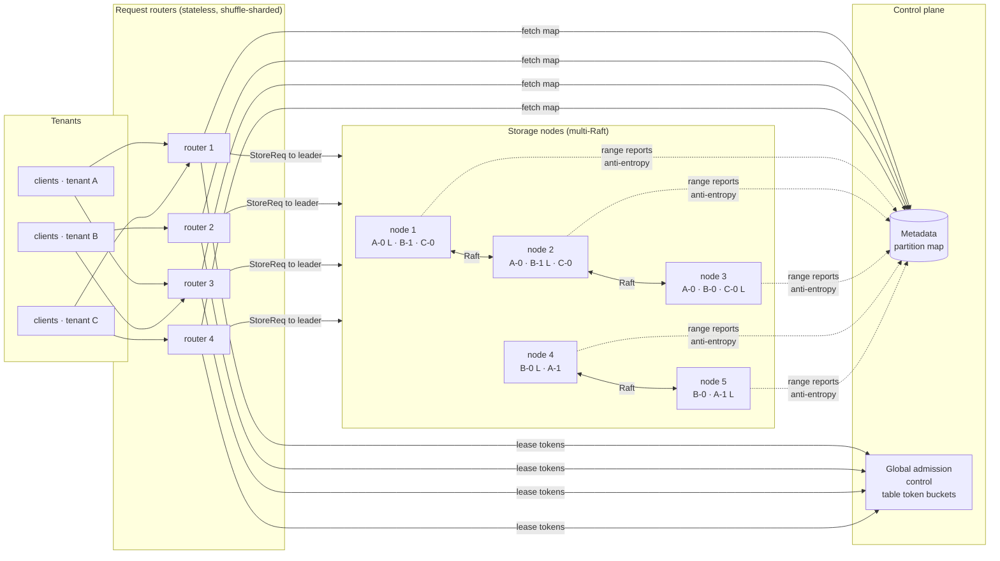
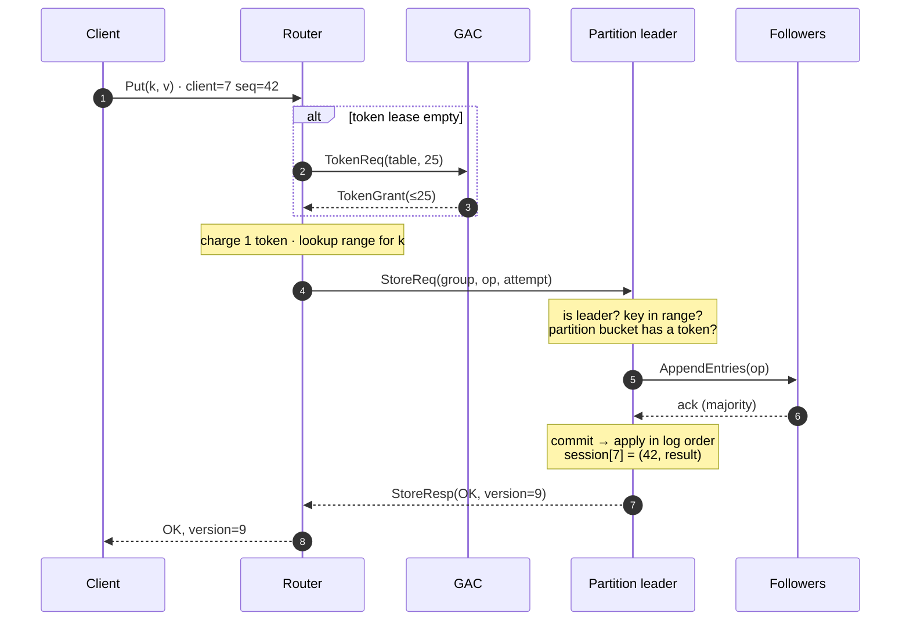

# Tessera

**A multi-tenant, partitioned, Raft-replicated key-value store — and the deterministic simulator that tries to break it.**

Tessera is a small but complete model of how a production multi-tenant database is put together: data is cut into key-range partitions, every partition is a 3-way Raft group, partitions that run hot split themselves at the point of maximum load, every tenant is rate-limited at two levels, and request routers are shuffle-sharded so one bad tenant cannot take everyone down.

The interesting part is not that it works on a sunny day. It is that **every run is a reproducible experiment under hostile conditions** — crashed nodes, network partitions, 20% packet loss, duplicated and reordered messages — and that **every single client operation is checked for linearizability afterwards**. If something is wrong, you get a seed that reproduces it bit-for-bit, and an explanation of exactly which read saw the impossible value.

```
$ go run ./cmd/tessera-sim -seeds 100
seed 1: LINEARIZABLE ✓  (11505 ops over 128 keys checked; wall 209ms)
seed 2: LINEARIZABLE ✓  (10347 ops over 128 keys checked; wall 188ms)
...
0/100 seeds failed  (wall 18.8s)
```

Each seed is 10 seconds of virtual time with ~8 injected faults, ~11k client operations, ~280k simulated events — and runs in ~200 ms of wall time.

Pure Go, standard library only, ~3.6k lines.

---

## Table of contents

- [Why this exists](#why-this-exists)
- [Architecture](#architecture)
- [The write path, step by step](#the-write-path-step-by-step)
- [Design decisions](#design-decisions)
  - [Raft as a pure state machine](#1-raft-as-a-pure-state-machine)
  - [Multi-Raft: one consensus group per partition](#2-multi-raft-one-consensus-group-per-partition)
  - [Exactly-once under retries: the session table](#3-exactly-once-under-retries-the-session-table)
  - [Splits as log entries](#4-splits-as-log-entries-split-triggers)
  - [Split for heat, not for size](#5-split-for-heat-not-for-size)
  - [Two-level admission control](#6-two-level-admission-control)
  - [Shuffle-sharded routers](#7-shuffle-sharded-routers)
  - [Being honest about ambiguity](#8-being-honest-about-ambiguity)
- [Deterministic simulation](#deterministic-simulation)
- [The linearizability checker](#the-linearizability-checker)
- [Proving the checker has teeth](#proving-the-checker-has-teeth)
- [Scenarios](#scenarios)
- [Running it](#running-it)
- [Repository layout](#repository-layout)
- [What is deliberately not here](#what-is-deliberately-not-here)
- [References](#references)

---

## Why this exists

Distributed storage bugs are rarely in the happy path. They live in interleavings: a leader that is partitioned away but doesn't know it yet, a retry that lands after a split, a duplicate packet that arrives after the original was rejected. Unit tests don't reach those states, and integration tests reach them by accident and then can't reproduce them.

Tessera is built around three convictions:

1. **Make the system deterministic, then let randomness drive it.** All time, scheduling, network behaviour and failures flow through one seeded event loop. A failing seed is a perfect bug report.
2. **Check the property, not examples.** Instead of asserting "after put(a), get returns a", record every operation with its real-time interval and ask: *is there any sequential order consistent with these observations?* That is linearizability, and it catches bugs no example-based test would think to look for.
3. **Prove the checker works by breaking the system on purpose.** A checker that never fails is indistinguishable from a checker that doesn't check. Tessera ships six injectable bugs; five are caught within a handful of seeds (see [below](#proving-the-checker-has-teeth)).

---

## Architecture



| Component | Role | State |
|---|---|---|
| **Storage node** | Hosts replicas of many partitions. Each replica = Raft peer + KV state machine + partition token bucket + heat tracker. | Durable: Raft log/term/vote and each replica's initial snapshot. Everything else is rebuilt by replay. |
| **Request router** | Looks up the partition for a key, charges the table's token budget, forwards to the partition leader, follows leader hints, retries across replicas, refreshes the map on `WrongRange`. | Soft only: cached map, leader hints, token lease. A router can crash at any time and lose nothing. |
| **Metadata** | Authoritative partition map. Fed by periodic reports from every storage node; merges by range generation, so lost/duplicated/reordered reports are harmless. | Partition map. |
| **Global admission control (GAC)** | One token bucket per table. Routers lease tokens in small batches, which is how a per-table limit holds across a fleet of routers that never talk to each other. | Table buckets. |
| **Client** | Closed-loop workload generator. One operation at a time, retries with the *same* sequence number, records every operation for the checker. | Its history. |

---

## The write path, step by step



Every arrow above can be dropped, delayed, duplicated or reordered by the simulator, and every box can crash.

---

## Design decisions

### 1. Raft as a pure state machine

`internal/raft` never touches a clock, a socket or a goroutine. The host feeds it three inputs and drains two outputs:

```go
r.Tick()               // one logical clock tick
r.Step(msg)            // a message from a peer
r.Propose(cmd)         // a new command (leader only)

r.Messages()           // → messages to send
r.Committed()          // → newly committed entries, in order
```

That makes the algorithm trivially drivable by a simulator, and makes "what does Raft do in state X when message Y arrives" a pure function you can test.

Durable state (`term`, `votedFor`, `log`) lives in a `*HardState` owned by the host's disk. Raft mutates it **before** emitting any message that depends on it, which is precisely the "persist before you reply" rule real implementations must fsync for. On restart, volatile state (role, commit index, applied index) starts from zero, exactly as in a real process.

Implemented: randomized elections, log replication with **fast conflict back-off** (skip a whole conflicting term per round trip), the **§5.4.2 rule** (only current-term entries are committed by counting replicas — older entries commit indirectly via a leader no-op), and **CheckQuorum** (a leader that can't hear a majority for an election timeout steps down instead of accepting proposals it can never commit).

### 2. Multi-Raft: one consensus group per partition

Each storage node hosts replicas of many partitions, each its own independent Raft group with its own leader. Leadership spreads across nodes naturally, a slow partition can't stall unrelated ones, and failover is per-partition. Messages are tagged with a group id and demultiplexed on arrival.

### 3. Exactly-once under retries: the session table

Networks lose responses. A client that times out cannot know whether its write happened, so it retries — and a naive system applies the write twice.

Every request carries `(clientID, seq)`. The state machine keeps, per client, the last sequence number it executed and that operation's result. A duplicate (same or lower `seq`) returns the cached result **without re-executing**. Because the table is part of the replicated state, it survives leader changes and crashes. Retries can then be fearless: through a different router, to a different replica, after a split.

### 4. Splits as log entries ("split triggers")

Splitting a live, replicated partition is where many systems get subtle bugs. Tessera's approach:

1. The leader proposes `SplitCmd{Key, ChildID, Gen}` **through the Raft log**.
2. Every replica applies it at the same log position, against the same state, and so derives a **byte-identical child snapshot** (keys ≥ split key, plus a copy of the session table) — no snapshot transfer, no coordination.
3. The child is a new Raft group on the same replicas, persisted before it does anything.
4. The parent's range shrinks and its generation increments.

Two guards make it safe:

- **Range checks happen in log order.** A request proposed before the split but committed after it is rejected with `WrongRange` at apply time instead of being written into a partition that no longer owns the key. Without this, the write is silently lost (this is the `no-range-check` bug).
- **Both halves inherit the session table.** A request applied in the parent before the split may be retried against the child after it; the child must recognise it (this is the `split-drop-sessions` bug).

Child IDs are `<parent>.<generation>`, so they're globally unique without an allocator. Replicas that lag behind create the child whenever they eventually apply the split; messages for a child they don't have yet are dropped and re-sent by the child's leader.

### 5. Split for heat, not for size

The partition leader samples per-key load over a sliding window (`admission.HeatTracker`). When the partition sustains ≥75% of its throughput ceiling, it splits at the **load-weighted median** — the boundary that minimises `|left load − right load|` — not at the middle of the key range or the data.

It also knows when *not* to split: if one key carries more than 85% of the heat, splitting would only move the problem, so the split is refused. That's the hot-item limitation every partitioned store has, and you can watch it happen in the [hot-partition scenario](#hot-partition-split-for-heat).

### 6. Two-level admission control

| Level | Where | Protects | Mechanism |
|---|---|---|---|
| **Table** | GAC, leased by routers | the tenant's provisioned budget, fleet-wide | token bucket per table; routers lease 25 tokens at a time and refill at half-empty |
| **Partition** | the partition leader | the storage node from a hot partition | hard-ceiling token bucket per partition, with burst credit |

Both are token buckets with burst credit: unused capacity accrues up to a cap, so a short spike above the rate is absorbed instead of throttled. A table-level throttle is decided **before** anything is forwarded, so the client knows for certain the write did not happen.

### 7. Shuffle-sharded routers

Each tenant is assigned a pseudo-random combination of `k` routers out of `n` (`internal/shuffle`). If a tenant sends a "query of death" that crashes every router it touches, only tenants whose *entire* shard is a subset of the bad tenant's shard lose service. Everyone else just fails over to their other router.

With `n` routers and shards of size `k`, the chance that another tenant has exactly your shard is `1 / C(n, k)`:

| routers `n` | shard `k` | combinations | P(full overlap) |
|---:|---:|---:|---:|
| 8 | 2 | 28 | 3.6% |
| 16 | 3 | 560 | 0.18% |
| 100 | 5 | 75,287,520 | 1.3 × 10⁻⁸ |

Compare that with no sharding (everyone shares everything: 100% blast radius) or plain sharding into `n/k` fixed groups (`k/n` blast radius).

### 8. Being honest about ambiguity

This is the part most toy implementations get wrong, and the checker is merciless about it.

Every outcome a router sends back is one of:

- **OK.** Applied exactly once; the result is real.
- **Definitely not applied.** Throttled before forwarding, not the leader, wrong range, no such group.
- **Maybe applied.** A timeout, or a leader that lost leadership with the proposal in flight.

The tricky case is **duplicated packets**. Suppose a request reaches a follower, gets `NotLeader`, and a duplicate copy of the same packet arrives 2 ms later — after that node has become leader. A naive node would propose it, and the "definitely not applied" answer would be a lie. Tessera's storage nodes remember recent rejections per `(router, request, attempt)` and answer duplicates identically. Routers do the same per `(client, seq, attempt)`.

Clients turn all of this into history records: OK → a completed operation; definitely-not-applied → nothing; maybe-applied → an **indeterminate** operation that the checker may place anywhere after its call, or nowhere at all.

---

## Deterministic simulation

`internal/sim` is a ~300-line discrete-event simulator:

- **Virtual time.** Nothing sleeps. The world jumps from event to event in a priority queue ordered by `(time, sequence)`, so ties break FIFO and deterministically.
- **One PRNG.** Latency, drops, duplicates, election timeouts, workload keys and the fault schedule all derive from one seed.
- **A hostile network.** 0.2–2 ms latency, 1% loss and 0.5% duplication by default. Faults escalate to 20% loss and 15 ms latency, and to arbitrary partitions between node sets.
- **Real crash semantics.** Crashing a node bumps its *incarnation*. Every timer and in-flight message addressed to the old incarnation silently disappears, just like volatile state in a dead process. Only what the node put in its `Disk` survives, and the factory rebuilds the node from it on restart.
- **Deterministic iteration everywhere.** Go randomizes map iteration order, so every loop whose order can influence the PRNG or message order iterates over sorted keys. Same seed, same run, every time.

The fault schedule injects, roughly once a second: storage-node crashes (0.2–1.7 s), isolation of a single storage node, two-node minority partitions (with routers still able to reach the minority side, so a stale leader there can be asked questions), packet-loss storms, and router crashes.

---

## The linearizability checker

`internal/checker` implements the **Wing–Gong / Lowe (WGL)** search with memoisation, the same algorithm used by Porcupine and Knossos.

- **Locality.** Linearizability is a *local* property (Herlihy & Wing, 1990): a history is linearizable if and only if each key's sub-history is. The checker splits the history per key, which turns one exponential search into many small ones. Around 11k operations check in a few milliseconds.
- **Model.** Each key is modelled as `(exists, value, version)`, with versions incremented on every write. Because writes return their new version, a double-applied write shows up as a version gap no sequential order can explain.
- **Indeterminate operations** get a return time of +∞ and an unknown output, so the search can place them anywhere after their call, or effectively never.
- **Explanations.** On failure you get the longest linearizable prefix and the operations that cannot be placed after it.

---

## Proving the checker has teeth

Each of these is a real class of bug that has shipped in real systems. Enable one with `-bug`:

| `-bug` | What it breaks | Caught |
|---|---|---|
| `local-reads` | Leaders answer reads from local state without confirming they're still leader. A deposed leader in a minority partition serves stale data. | seed 4 |
| `no-dedup` | The state machine ignores the session table, so duplicated or retried requests apply twice. | seed 1 |
| `no-range-check` | No in-log range check: writes committed after a split land in a partition that no longer owns the key and are lost. | seed 1 |
| `split-drop-sessions` | Split children don't inherit the session table, so a retry after a split re-executes. | seed 1 |
| `router-new-seq` | Routers retry under a fresh sequence number, defeating dedup. | seed 1 |
| `unsafe-commit` | Raft commits prior-term entries by counting replicas (Figure 8 of the Raft paper). | not yet found by random search (see below) |

Here is what `local-reads` looks like:

```
$ go run ./cmd/tessera-sim -bug local-reads -seed 4

seed 4: NOT LINEARIZABLE ✗  (11429 ops over 128 keys checked)
  faults injected:
      1457.9ms  partition storage {n4,n3} from the other storage nodes for 1.478s
      ...
  key carts/k0002: NOT linearizable (231 ops)
    last linearizable prefix:
      ✓ c18 carts/k0002 put("c18.393") → v3  [9154.988ms, 9161.589ms]
      ✓ c18 carts/k0002 put("c18.401") → v4  [9228.540ms, 9440.967ms]
    no valid order exists for:
      ✗ c15 carts/k0002 get → "c18.393"@v3  [9448.044ms, 9453.491ms]
```

The write of v4 *completed* at 9440.97 ms. A read that *started* 7 ms later returned v3. No sequential order allows that: it's a stale read from a leader that had already been replaced.

**About `unsafe-commit`.** The Figure 8 anomaly needs a very specific sequence: a leader replicates an old-term entry to a majority, crashes, and a competing leader with a different entry at that index wins the next election before the first one returns. Uniform random faults rarely produce it. It's kept as an open target for a fault schedule that's biased towards leader crashes right after replication.

---

## Scenarios

### Default: three tenants under chaos

```
$ go run ./cmd/tessera-sim -seed 1
seed 1: LINEARIZABLE ✓  (11505 ops over 128 keys checked; wall 209ms)

  tenant           ok  throttled   failed  unknown       p50       p99
  carts          2454          0        0        2    6.24ms  411.49ms
  orders         5844         79        6        7    6.12ms  409.63ms
  sessions       3198         54        0        0    7.34ms  409.52ms

  network: 224433 sent, 217015 delivered, 5298 dropped, 1096 duplicated, 3205 cut by partitions
  events: 283067   crashes: 4   restarts: 4
```

The p99 of ~410 ms is the client's 400 ms attempt timeout firing when a router or leader died mid-request, followed by a successful retry. That's exactly the latency cliff failover costs, and the main thing to improve next (hedged requests, faster leader-loss detection).

### Hot partition: split for heat

One tenant, one starting partition, 48 clients on a Zipf-skewed key space, at ~4× the partition ceiling:

```
$ go run ./cmd/tessera-sim -scenario hot-partition -seed 7
  splits: 12 (refused: 4)   partition throttles: 4172

  final partition map:
    hot/hot-0["","k0001")@g3
    hot/hot-0.2["k0001","k0002")@g3
    hot/hot-0.2.2["k0002","k0003")@g1
    hot/hot-0.2.1["k0003","k0005")@g2
    hot/hot-0.2.1.1["k0005","k0008")@g1
    hot/hot-0.1["k0008","k0011")@g4
    ...
    hot/hot-0.1.1.1.1["k0157","∞")@g1
```

Look at the shape: the hot end of the key space (`k0000`–`k0010`) is cut into partitions holding one or two keys each, while the cold tail `k0157`–`∞` stays as one partition. That's what splitting at the load median gives you, as opposed to splitting at the data median. The four refused splits are the partition holding only `k0000`, the hottest key, where splitting can't help.

### Poison tenant: shuffle sharding

Eight tenants and eight routers with shards of 2, plus a tenant whose requests crash any router that parses them:

```
$ go run ./cmd/tessera-sim -scenario poison -seed 3
  tenant           ok  throttled   failed  unknown
  tenant00       1483          0        0        0
  tenant01       1910          0        0        0
  ...
  tenant07       1801          0        0        0

  poison crashes: 24
```

Routers were killed 24 times and no other tenant lost a single operation: everyone with at least one router outside the poison shard failed over.

---

## Running it

Requires Go 1.22+. No dependencies.

```bash
go test ./...
```

```bash
go run ./cmd/tessera-sim -seed 1
```

```bash
go run ./cmd/tessera-sim -seeds 500
```

```bash
go run ./cmd/tessera-sim -seed 42 -trace | less
```

```bash
go run ./cmd/tessera-sim -bug local-reads -seeds 50
```

```bash
go run ./cmd/tessera-sim -scenario hot-partition -v
```

Flags: `-seed`, `-seeds`, `-duration` (virtual), `-faults=false`, `-bug <name>`, `-scenario default|calm|hot-partition|poison`, `-trace`, `-v`, `-stop=false` (keep sweeping after a failure).

When a sweep fails, it prints the exact command to reproduce the failing seed.

---

## Repository layout

```
cmd/tessera-sim/        CLI: seed sweeps, scenarios, bug injection, traces
internal/sim/           deterministic discrete-event simulator (time, network, crashes, disks)
internal/raft/          Raft as a pure Tick/Step/Propose state machine + chaos safety tests
internal/kv/            per-partition state machine: items, versions, CAS, sessions, split trigger
internal/admission/     token buckets with burst credit, heat tracking, load-weighted split keys
internal/shuffle/       shuffle-shard assignment and blast-radius math
internal/checker/       WGL linearizability checker with per-key decomposition + tests
internal/cluster/       storage nodes, routers, metadata, GAC, clients, fault schedule, reports
```

The Raft tests run 40 seeds of a 5-node cluster under crashes, restarts and partitions, and assert the core Raft invariants on every step: **election safety** (at most one leader per term) and **state machine safety** (no two nodes ever apply different entries at the same index).

---

## What is deliberately not here

Scope was chosen so that every included piece is correct, rather than every piece being present.

- **Log compaction / snapshots.** Logs grow without bound and restarts replay from index 1. The split machinery already has a snapshot type, so compaction would mean persisting a snapshot plus a log suffix.
- **Membership changes and rebalancing.** Children stay on their parent's replicas. Moving replicas needs joint consensus or single-server changes.
- **Pre-vote.** A partitioned node inflates its term and disrupts the group when it rejoins. That costs availability, not safety.
- **Read leases / ReadIndex.** All reads go through the log. That's correct but slower; `local-reads` shows what happens if you shortcut it naively.
- **Replicated control plane.** Metadata and GAC are single processes that never crash in the simulation. The protocol already tolerates lost, duplicated and stale reports, so making them Raft groups is mechanical.
- **Real network and disk.** Everything runs in the simulator. Swapping `sim.World` for TCP and fsync is an interface boundary, not a redesign.

---

## References

- Diego Ongaro & John Ousterhout, *In Search of an Understandable Consensus Algorithm (Raft)*, USENIX ATC 2014.
- Maurice Herlihy & Jeannette Wing, *Linearizability: A Correctness Condition for Concurrent Objects*, TOPLAS 1990.
- Jeannette Wing & Chun Gong, *Testing and Verifying Concurrent Objects*, JPDC 1993; Gavin Lowe, *Testing for Linearizability*, CC:PE 2017.
- Anish Athalye, *Porcupine: a fast linearizability checker*.
- Kyle Kingsbury, the *Jepsen* analyses.
- The FoundationDB team's talks and writing on deterministic simulation testing.
- The etcd/raft library, for the "Ready" style of driving Raft.
